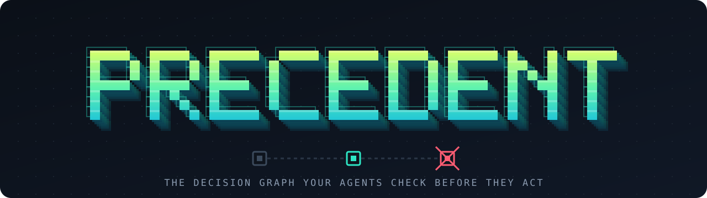
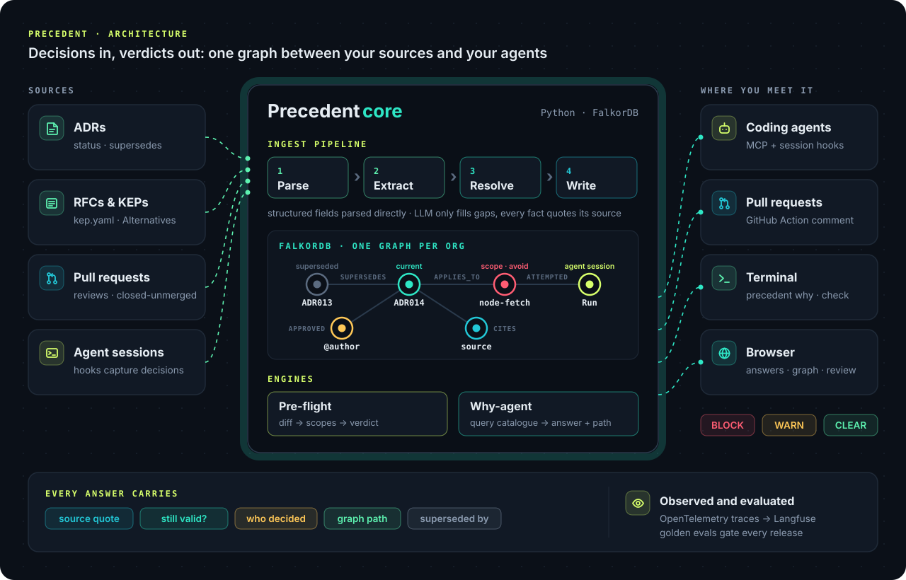

<p align="center">
  
</p>

<h1 align="center">Precedent</h1>

<p align="center">
  <a href="docs/spec.md">Spec</a> ·
  <a href="docs/adr">Decisions</a> ·
  <a href="CONTRIBUTING.md">Contributing</a> ·
  <a href="SECURITY.md">Security</a>
</p>

<p align="center">
  <a href="LICENSE"></a>
  <a href="pyproject.toml"></a>
  <a href="https://www.falkordb.com"></a>
  <a href="https://modelcontextprotocol.io"></a>
  <br>
  <a href="https://www.wemakedevs.org/hackathons/falkordb"></a>
  <a href="CONTRIBUTING.md"></a>
</p>

<p align="center"><b>A decision graph that coding agents and PRs check before they act.</b></p>

Teams make decisions every week: use native `fetch`, not `node-fetch`; don't enable swap with `--fail-swap-on=false`; keep REST for public APIs. Then those decisions get superseded, forgotten, or re-litigated by a coding agent that never saw them.

Precedent ingests decisions from ADRs, RFCs/KEPs and pull requests into a [FalkorDB](https://www.falkordb.com) graph. It knows **why** each decision was made, **whether it still holds**, **what code it applies to**, and **who decided**. Agents and CI ask it before they change anything.

```
$ precedent check --org backstage --diff pr.diff
WARN  node-fetch: ADR013 was superseded by ADR014 — Node.js code uses native fetch.
      source: docs/architecture-decisions/adr014-use-fetch.md#decision
```

> Status: in development for [Graph Hacks](https://www.wemakedevs.org/hackathons/falkordb) (Oct 15–18, 2026). See [docs/spec.md](docs/spec.md).

## How it works

<p align="center">
  
</p>

1. **Ingest** — connectors (`adr`, `kep`, `github`) turn sources into one `DecisionRecord` shape. Structured fields are parsed directly; an LLM fills scope and rejected alternatives, and every extracted fact must quote its source.
2. **Graph** — decisions, scopes (paths, packages, components), people, rejected approaches and sources live in FalkorDB, one graph per org. Nothing is deleted: changed facts get an `invalid_at` date.
3. **Check** — pre-flight matches a diff or an agent's plan against current decisions and returns BLOCK, WARN or CLEAR with the source path. Only confirmed decisions from structured sources can block.
4. **Remember** — agents record attempts and propose decisions over MCP; a human confirms them.

## Use it from

| Surface | Command |
|---|---|
| CLI | `precedent why "…"`, `precedent check --diff -` |
| Coding agents (MCP) | `decisions_for`, `why`, `preflight`, `record_decision`, `record_attempt` |
| Pull requests | GitHub Action posts a comment on decisions the diff touches |
| Browser | `precedent serve` → ask, pre-flight, graph path, review queue |

## Quick start (planned)

```sh
docker compose up -d                 # FalkorDB + Browser on :3000
cp .env.example .env                 # add ANTHROPIC_API_KEY
uv sync
uv run precedent ingest adr docs/adr --org precedent
uv run precedent why "why is FalkorDB the only store?" --org precedent
```

## Project decisions

Precedent records its own decisions in [`docs/adr/`](docs/adr) and ingests them as its first dataset.

## AI assistance

Built with help from Claude Code. Disclosed per hackathon rules.

## Contributing

See [CONTRIBUTING.md](CONTRIBUTING.md) and our [Code of Conduct](CODE_OF_CONDUCT.md). Report security issues privately: [SECURITY.md](SECURITY.md).

## License

[Apache-2.0](LICENSE)
