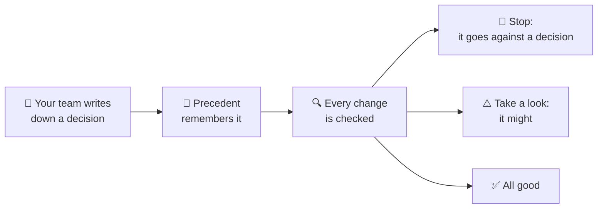

<p align="center">
  
</p>

# Precedent

**Precedent stops people and AI coding assistants from undoing your team's decisions.**

📖 **[Read the docs](https://dhruvalgupta2003.github.io/precedent/)** (plain words, with pictures) ·
▶️ **[See it in 2 minutes](https://dhruvalgupta2003.github.io/precedent/try/)**

## The problem

1. Your team decides something. For example: "we use Luxon for dates, not Moment."
2. An old note still says "use Moment". Nobody remembers to change it.
3. An AI coding assistant reads that note and brings Moment back. Nobody notices for weeks.

## How Precedent helps



When Precedent stops a change, it says which decision and why, so the person or the AI assistant can fix it.
It checks changes before an AI assistant edits a file, and on every pull request.

## Try it

The [2-minute guide](https://dhruvalgupta2003.github.io/precedent/try/) walks you through it step by step. If you
already have [Docker](https://www.docker.com/products/docker-desktop/) and
[uv](https://docs.astral.sh/uv/getting-started/installation/), it's four commands:

```sh
git clone https://github.com/dhruvalgupta2003/precedent && cd precedent
docker compose up -d
uv run precedent load examples/backstage
uv run precedent check --diff examples/changes/adds-moment-timezone.diff
```

The last command answers **🛑 Stop**: the example change brings Moment back, against the team's decision.

## Use it on your project

Follow [Set it up for your team](https://dhruvalgupta2003.github.io/precedent/setup/). It takes about 10 minutes.

## Does it work?

In our tests, an AI assistant worked from an outdated note. Without Precedent, it followed the team's current
decision **0 times out of 5**. With Precedent, **5 times out of 5**.
[All the results](https://dhruvalgupta2003.github.io/precedent/evidence/).

It's early (version 0.2), so there are [things it can't do yet](https://dhruvalgupta2003.github.io/precedent/limits/).

## More

[Contributing](CONTRIBUTING.md) · [Code of conduct](CODE_OF_CONDUCT.md) · [Security](SECURITY.md) ·
[Design decisions](docs/adr) · License: [Apache-2.0](LICENSE) · Built on [FalkorDB](https://www.falkordb.com)

Built with help from Claude Code.
