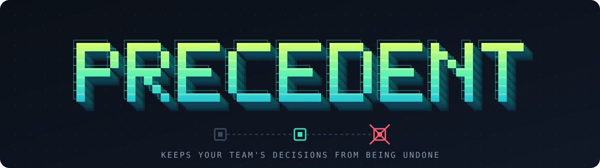
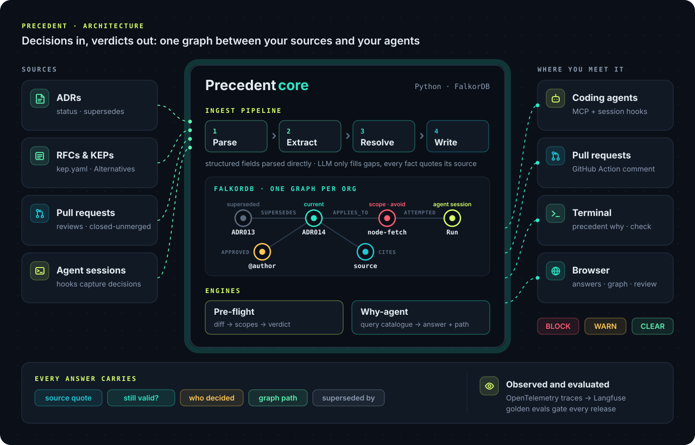

<p align="center">
  
</p>

<h1 align="center">Precedent</h1>

<p align="center">
  <a href="docs/spec.md">Spec</a> ·
  <a href="docs/adr">Decisions</a> ·
  <a href="CONTRIBUTING.md">Contributing</a> ·
  <a href="SECURITY.md">Security</a>
</p>

<p align="center">
  <a href="LICENSE"></a>
  <a href="pyproject.toml"></a>
  <a href="https://www.falkordb.com"></a>
  <a href="https://modelcontextprotocol.io"></a>
  <br>
  <a href="https://www.wemakedevs.org/hackathons/falkordb"></a>
  <a href="CONTRIBUTING.md"></a>
</p>

<p align="center"><b>A decision graph that coding agents and PRs check before they act.</b></p>

Teams make decisions every week: use native `fetch`, not `node-fetch`; don't enable swap with `--fail-swap-on=false`; keep REST for public APIs. Then those decisions get superseded, forgotten, or re-litigated by a coding agent that never saw them.

Precedent ingests decisions from ADRs, RFCs/KEPs and pull requests into a [FalkorDB](https://www.falkordb.com) graph. It knows **why** each decision was made, **whether it still holds**, **what code it applies to**, and **who decided**. Agents and CI ask it before they change anything.

```
$ precedent check --org backstage --diff pr.diff
WARN  node-fetch: ADR013 was superseded by ADR014 — Node.js code uses native fetch.
      source: docs/architecture-decisions/adr014-use-fetch.md#decision
```

> Status: in development for [Graph Hacks](https://www.wemakedevs.org/hackathons/falkordb) (Oct 15–18, 2026). See [docs/spec.md](docs/spec.md).

## How it works

<p align="center">
  
</p>

1. **Ingest** — connectors (`adr`, `kep`, `github`) turn sources into one `DecisionRecord` shape. Structured fields are parsed directly; an LLM fills scope and rejected alternatives, and every extracted fact must quote its source.
2. **Graph** — decisions, scopes (paths, packages, components), people, rejected approaches and sources live in FalkorDB, one graph per org. Nothing is deleted: changed facts get an `invalid_at` date.
3. **Check** — pre-flight matches a diff or an agent's plan against current decisions and returns BLOCK, WARN or CLEAR with the source path. Only confirmed decisions from structured sources can block.
4. **Remember** — agents record attempts and propose decisions over MCP; a human confirms them.

## Quick start

```sh
docker compose up -d                       # FalkorDB on localhost:6380
cp .env.example .env                       # optional: an LLM key, so it can read which code each ADR covers
uv sync

# 1. Load your decisions: ADR folders in Backstage, MADR, adr-tools/Nygard or front-matter style
uv run --env-file .env precedent ingest docs/adr --org myteam

# 2. Check a change against the decisions that are still valid
git diff main | uv run precedent check --org myteam          # exit 0 CLEAR, 1 WARN, 2 BLOCK

# 3. Guard Claude Code: before an edit, the agent gets the current decision and its quote
uv run precedent hooks install --org myteam                  # writes .claude/settings.local.json
uv run precedent hooks install --org myteam --user           # or: guard every repo you open

# 4. Find lines in CLAUDE.md / AGENTS.md / Cursor / Copilot rules that contradict a current decision
uv run --env-file .env precedent doctor --org myteam          # exit 1 if any (CI)
```

What the agent sees when it is about to add `node-fetch` to a Backstage backend:

```
Precedent WARN: this change touches decisions the team recorded.
- backstage/ADR014 says avoid node-fetch: "We will gradually transition away from third party `fetch`
  replacement packages such as `node-fetch` and others on the Node.js platform."
- backstage/ADR013 (require node-fetch) was replaced by backstage/ADR014: "Backend (node) packages should
  use the `node-fetch` package for HTTP data fetching."
```

It stays silent when nothing matches. Only decisions from a structured source that a human confirmed can block;
anything the AI read from prose can only warn ([ADR0004](docs/adr/0004-only-confirmed-decisions-block.md)).
If Precedent itself fails, the hook lets the edit through.

## Does it work?

We ran real Claude Code sessions on a repo whose `CLAUDE.md` still says to use `node-fetch`, after the team moved to native `fetch` ([E1](evals/experiments/e1/README.md)):

| How often the agent followed the current decision | Decision in the repo | Decision not in the repo |
|---|---|---|
| Stale `CLAUDE.md` | 2/5 | 0/5 |
| Stale `CLAUDE.md` + "this file may be out of date" | 5/5 | 0/5 |
| **Stale `CLAUDE.md` + Precedent** | **5/5** | **5/5** |

Across three repos and three decisions held only in a central decision graph ([E2](evals/experiments/e2/README.md)), the stale file and the one-sentence fix both got 0/9; with Precedent, 9/9.

If your newer decision sits next to the code, a one-line note in `CLAUDE.md` already helps. Precedent matters when it doesn't: decisions kept in a central repo, a PR thread or another team's ADRs. Small study (5 runs each, one task, one model); the harness is in the repo so you can rerun it.

On real Backstage history, the check flagged 9 of 9 PRs that added a package their ADRs advise against, and none of the 79 PRs merged in an ordinary week.

## Use it from

| Surface | Status |
|---|---|
| CLI: `ingest`, `check`, `doctor`, `hooks install` | ✅ |
| Claude Code `PreToolUse` hook | ✅ |
| CLI: `why`, `review`, `context`, `capture` | planned |
| MCP server, GitHub Action, web page | planned |

## Project decisions

Precedent records its own decisions in [`docs/adr/`](docs/adr) and ingests them as its first dataset.

## AI assistance

Built with help from Claude Code. Disclosed per hackathon rules.

## Contributing

See [CONTRIBUTING.md](CONTRIBUTING.md) and our [Code of Conduct](CODE_OF_CONDUCT.md). Report security issues privately: [SECURITY.md](SECURITY.md).

## License

[Apache-2.0](LICENSE)
