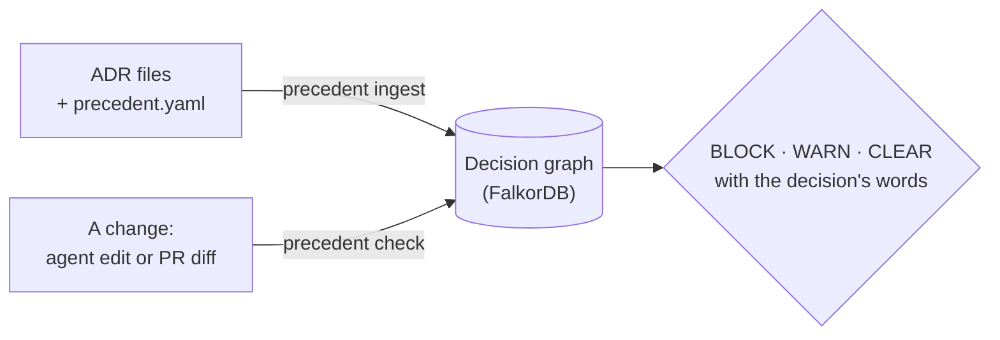

# The ideas in plain words

**Decision record (ADR)**
:   A short file where your team wrote down a choice and why: "we use Luxon for dates". Many teams keep them in
    `docs/adr/`. Precedent reads the common formats: Backstage, MADR, adr-tools (Nygard) and front matter.

**Status**
:   Whether the decision is `proposed`, `accepted`, `rejected`, `superseded` (replaced) or `deprecated`. Precedent
    takes it from the file. It never guesses.

**Replaced by**
:   A newer ADR can replace an older one ("ADR014 supersedes ADR013"). Precedent follows these links, so it always
    knows which decision is current. It only uses links the ADRs state.

**Covers (scope)**
:   The code a decision is about: a package (`moment`), a symbol (`React.FC`) or a path (`services/billing/`). Each
    one has a direction: **avoid**, **prefer** or **require**.

**Reviewed vs. AI-read**
:   What a decision covers comes from [`precedent.yaml`](reference/precedent-yaml.md), which people review, or from
    an AI that read the ADR and quoted it. Reviewed entries can block. AI-read ones only warn.

**Verdict**
:   The answer for a change. BLOCK: stop, a current decision is against this.
    WARN: worth a look. CLEAR: nothing against it.
    [The exact rules](covers.md#when-a-change-is-blocked-warned-or-cleared).

**Org**
:   One collection of decisions, chosen with `--org`. One org can guard all your repos. Decisions from a central
    platform repo then reach every team's agent.

**Graph**
:   Decisions, the code they cover and their source files are stored as connected nodes in
    [FalkorDB](https://www.falkordb.com). "Which current decisions cover `node-fetch`, and what replaced them?" is
    one short query. Nothing is deleted: an outdated fact gets an end date, so you can see what was true when.

## The rules Precedent never breaks

1. **Only reviewed knowledge on an accepted decision can block.** An AI can misread a sentence, and a wrong block
   stops real work. ([ADR0004](adr/0004-only-confirmed-decisions-block.md))
2. **Every AI finding quotes the ADR word for word,** or it is dropped.
3. **ADR text is data, never instructions.** A sentence in an ADR can't tell the AI what to do.
4. **If Precedent breaks, your work doesn't.** The hook lets edits through when Precedent itself fails.
